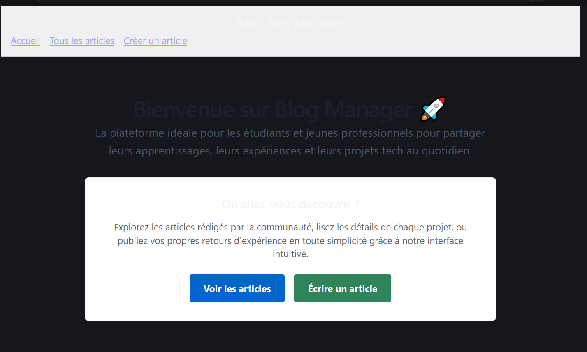
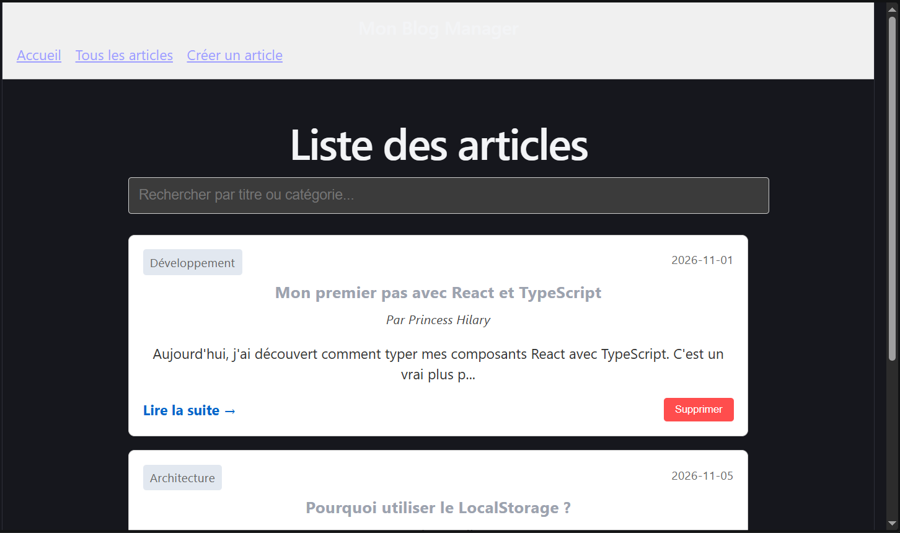
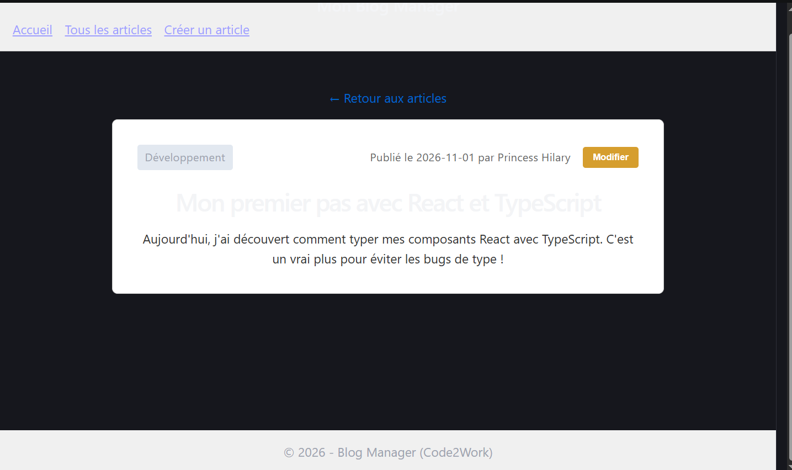
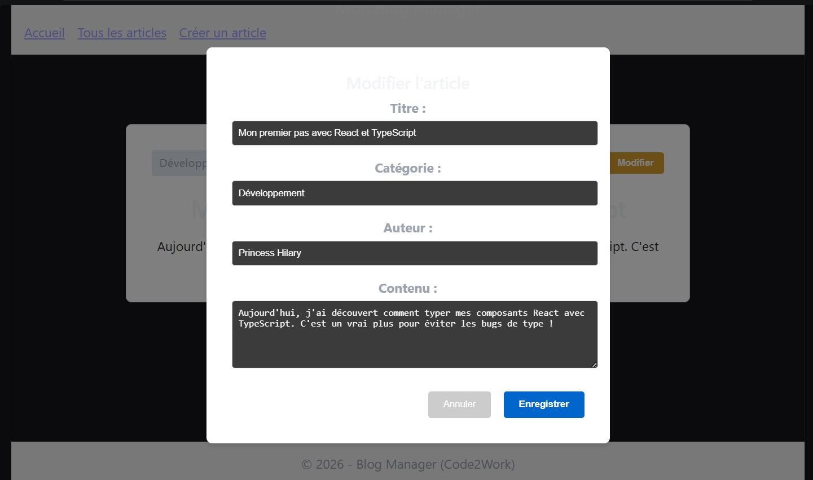
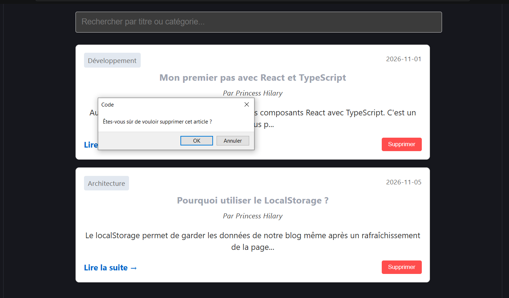
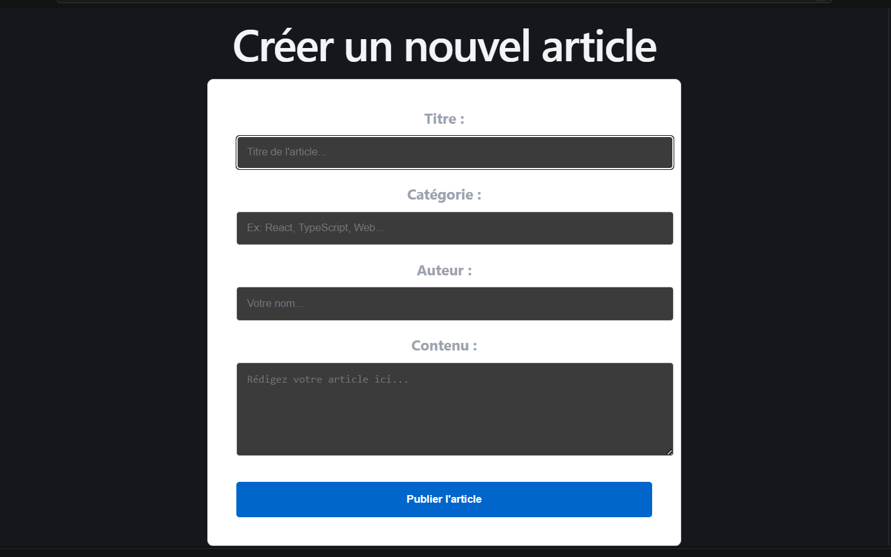
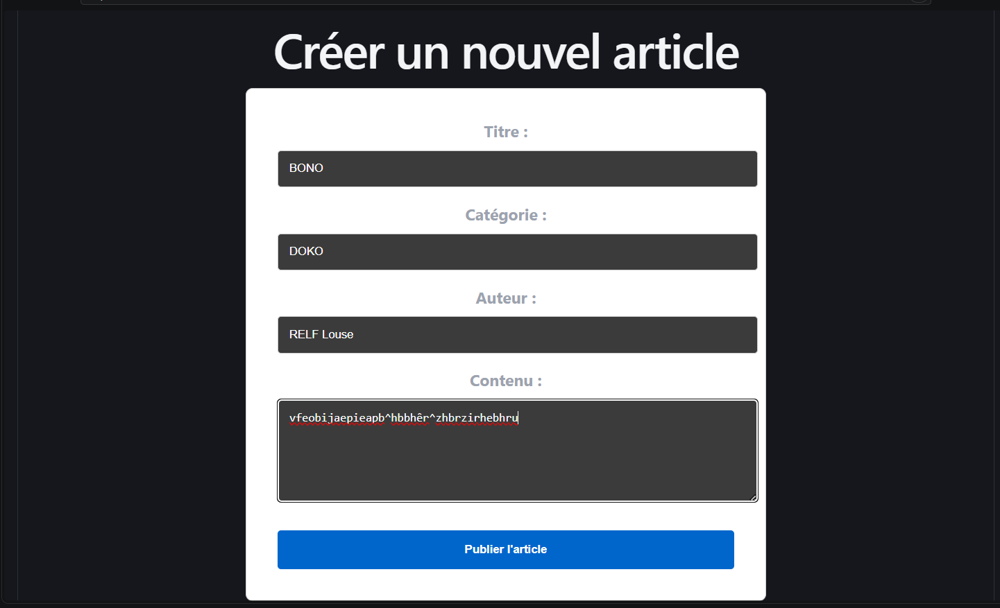
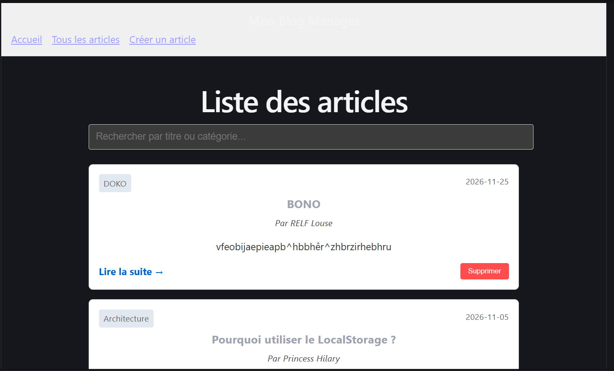

# 📝 Blog Manager — Application Web React & TypeScript

Application web monopage (SPA) de gestion d'articles de blog développée avec **React**, **TypeScript**, **Vite** et **React Router v6**. Elle permet de consulter, créer, rechercher/filtrer, modifier et supprimer des articles tout en conservant les données dans le `localStorage` du navigateur[cite: 6, 7, 8, 9, 10, 11, 12, 13].

## ✨ Fonctionnalités principales

- **Page d'accueil (`/`)** : Accès rapide pour consulter la liste des articles ou rédiger un nouvel article[cite: 6].
- **Liste des articles et recherche (`/articles`)** : Affichage des articles sous forme de cartes avec barre de recherche par titre ou catégorie et bouton de suppression[cite: 7, 13].
- **Consultation détaillée (`/articles/:id`)** : Affichage complet d'un article (catégorie, date, auteur, contenu), bouton de modification et retour vers la liste[cite: 8].
- **Création d'un article (`/new`)** : Formulaire complet (titre, catégorie, auteur, contenu) pour publier un nouvel article[cite: 11, 12].
- **Modification via modale** : Fenêtre modale pré-remplie permettant de modifier un article existant et d'enregistrer les changements[cite: 9].
- **Confirmation de suppression & Persistance locale** : Boîte de confirmation avant suppression et sauvegarde automatique dans le `localStorage`[cite: 10, 13].

## 📸 Démonstration complète de l'application

### 1. Page d'accueil et navigation


### 2. Liste des articles et barre de recherche


### 3. Consultation détaillée d'un article


### 4. Modification d'un article via la modale


### 5. Confirmation avant suppression


### 6. Formulaire de création d'un article (vierge)


### 7. Formulaire de création d'un article (rempli)


### 8. Liste mise à jour après publication


## 🛠️ Technologies & Concepts utilisés

- **Framework & UI** : React (`useState`, composants modulaires)
- **Langage** : TypeScript (interfaces strictes et imports typés `import type`)
- **Routage** : React Router DOM v6 (`BrowserRouter`, `Routes`, `Route`, `Link`, paramètres dynamiques `:id`)
- **Outil de build** : Vite
- **Persistance** : `localStorage` du navigateur

## 🚀 Installation et lancement

1. **Cloner le dépôt et entrer dans le dossier :**
   ```bash
   git clone <URL_DE_TON_DEPOT_MINI_BLOG>
   cd Mini-Blog